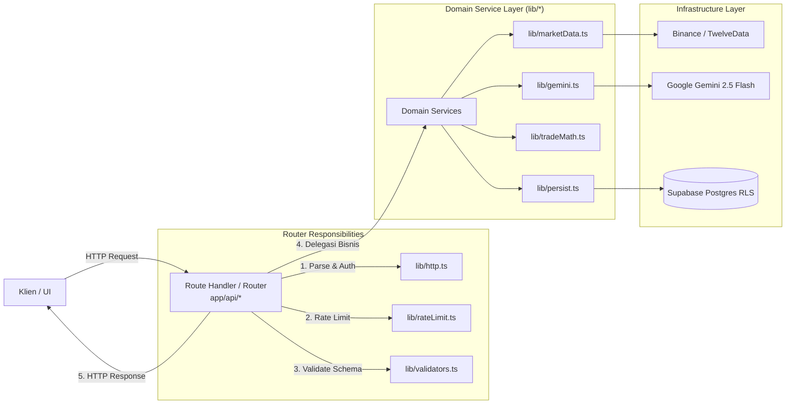
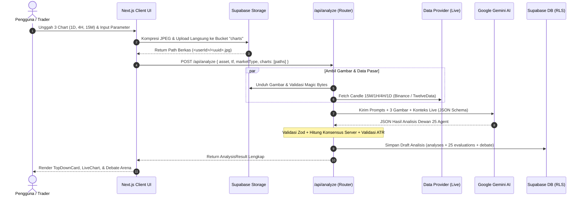

# Product Requirements Document (PRD): MarketMind AI Professional

---

## 1. Ringkasan Eksekutif & Deskripsi Sistem

**MarketMind AI Professional** adalah sistem pendukung keputusan trading multi-aset (*Decision Support Engine*) tingkat institusional yang mengorkestrasi **Dewan 25 Agent AI Spesialis**. Sistem ini dirancang untuk menghilangkan bias emosional pedagang ritel dengan menggabungkan analisis visual grafik multi-timeframe (*Top-Down Vision*), data harga live real-time, konsensus matematis yang dihitung di server, manajemen risiko ketat, serta pelacakan akurasi historis agent berbasis statistik interval kepercayaan Wilson 95%.

Sistem dibangun melalui 5 fase evolusi:
1. **Fase 1 — Core Decision Engine:** Standarisasi 25 profil agent pakar, konsensus kalkulasi server, validasi skema Zod ketat, dan pembatasan laju (*rate limiting*) Upstash Redis.
2. **Fase 2 — Multi-Timeframe Vision & Live Market Data:** Unggah 3 grafik visual (Daily, 4H, 15M) ke Supabase Storage, streaming data candle live (Binance & TwelveData), cache terdistribusi *single-flight*, dan deteksi deviasi harga vs ATR.
3. **Fase 3 — Database, Jurnal Trading, & Akurasi Agent:** Penyimpanan otomatis draft analisis, validasi geometri setup (Long/Short, R:R), pencatatan jurnal hasil (*Win/Loss/Breakeven*), dan pemeringkatan dewan agent.
4. **Fase 4 — Kanal Notifikasi & Ekspor:** Bot Telegram interaktif (kode otentikasi sekali pakai), webhook Discord pribadi anti-SSRF, cron evaluasi SL/TP otomatis, dan generator laporan PDF server-side.
5. **Fase 5 — Performa, UX, & Debate Arena:** UI arena debat responsif (Grid vs Compact Table), filter pencarian instan keyboard `/`, lazy-loading komponen, dan skeleton status aksesibilitas.

---

## 2. Struktur Direktori Proyek (*Code Tree Path*) & Penjelasan Sederhana

Berikut adalah peta struktur repositori beserta penjelasan peran setiap direktori dan file inti:

```text
marketmind-pro/
├── app/                                # Direktori Utama Next.js App Router
│   ├── api/                            # Backend API Route Handlers (Service Router Layer)
│   │   ├── agents/leaderboard/         # Endpoint peringkat akurasi 25 agent (Wilson Score)
│   │   ├── alerts/                     # Endpoint pengelolaan trigger alert harga
│   │   ├── analyses/                   # Endpoint riwayat dan status penyimpanan analisis
│   │   ├── analyze/                    # Engine utama inferensi 25 agent multi-timeframe
│   │   ├── chat/                       # Diskusi interaktif dengan dewan agent (Gemini)
│   │   ├── cron/                       # Endpoint tugas terjadwal (cleanup draft & evaluasi alert)
│   │   ├── export/pdf/                 # Pembuatan laporan PDF server-side (@react-pdf/renderer)
│   │   ├── journal/                    # CRUD jurnal trading & konfirmasi hasil trade (outcomes)
│   │   ├── market/candles/             # Data candle pasar live (Binance / TwelveData) + cache
│   │   ├── notifications/              # Status kanal notifikasi pengguna
│   │   ├── share/discord/              # Pengiriman sinyal/kartu analisis ke Discord webhook
│   │   └── telegram/                   # Webhook bot Telegram & pertukaran kode pairing
│   ├── auth/callback/                  # Handler pertukaran token autentikasi Supabase
│   ├── dev/debate/                     # Test harness pengujian komponen arena debat
│   ├── journal/page.tsx                # Halaman UI Jurnal Trading
│   ├── leaderboard/page.tsx            # Halaman UI Leaderboard Akurasi Agent
│   ├── login/page.tsx                  # Halaman otentikasi (Magic link / Password)
│   ├── settings/notifications/page.tsx # Halaman konfigurasi Telegram & Discord
│   ├── error.tsx                       # Global Error Boundary tingkat rute
│   ├── layout.tsx                      # Root layout, penyedia tema gelap, & AppShell
│   ├── not-found.tsx                   # Halaman 404 ramah pengguna
│   └── phase5.css                      # Utilitas styling khusus aksesibilitas & animasi mikro
├── components/                         # Komponen Antarmuka Pengguna (UI Layer)
│   ├── AddToJournalDialog.tsx          # Dialog modal konfirmasi trade setup ke jurnal
│   ├── AgentCard.tsx                   # Kartu visual detail profil dan argumen agent
│   ├── AnalysisSkeleton.tsx            # Skeleton pemuatan saat analisis 10–40 detik berjalan
│   ├── AppShell.tsx                    # Navigasi atas, link skip-to-content, & ToastProvider
│   ├── BiasBadge.tsx                   # Badge status bias (Bullish/Bearish/Netral) multi-indera
│   ├── ChartUploader.tsx               # Komponen unggah gambar chart dengan kompresi lokal
│   ├── ChatPanel.tsx                   # Panel diskusi interaktif tanya-jawab dengan dewan agent
│   ├── CompactAgentTable.tsx           # Tampilan tabel ringkas 25 agent untuk perbandingan cepat
│   ├── DebateArena.tsx                 # Arena visual benturan argumen antar agent dan konsensus
│   ├── DiscordModal.tsx                # Modal kirim analisis ke webhook Discord pribadi
│   ├── EmptyState.tsx                  # Tampilan fallback saat data belum tersedia
│   ├── ErrorBoundary.tsx               # Penangkap error React komponen agar UI tidak crash
│   ├── ErrorState.tsx                  # Tampilan pesan gagal analisis beserta tombol retry
│   ├── ExportPdfButton.tsx             # Tombol pemanggil unduh dokumen PDF server-side
│   ├── Highlight.tsx                   # Penyorot kata kunci pencarian tanpa kerentanan XSS
│   ├── Leaderboard.tsx                 # Tabel visual peringkat efektivitas 25 agent
│   ├── LiveChart.tsx                   # Grafik candlestick interaktif (Lightweight Charts v5)
│   ├── MultiTimeframeUploader.tsx      # Slot uploader 3 timeframe (1D, 4H, 15M)
│   ├── QuickFilter.tsx                 # Kolom pencarian cepat dengan pintasan tombol '/'
│   ├── SaveAnalysisButton.tsx          # Tombol penanda bookmark analisis permanen
│   ├── ShareButton.tsx                 # Tombol pembuka integrasi share sosial/webhook
│   ├── Skeleton.tsx                    # Primitif skeleton loader
│   ├── TelegramSettings.tsx            # Pengaturan pairing bot Telegram dengan kode unik
│   ├── Toast.tsx                       # Sistem notifikasi toast ringan berbasis React Context
│   ├── TopDownCard.tsx                 # Kartu ringkasan konfluensi top-down multi-timeframe
│   ├── TradingJournal.tsx              # Tabel riwayat trade, statistik Win Rate, & Profit Factor
│   └── lazy.tsx                        # Pembungkus dynamic import untuk komponen berat
├── docs/                               # Dokumentasi Arsitektur & Spesifikasi Sistem
│   ├── PRD.md                          # Product Requirements Document (Dokumen ini)
│   ├── souls.md                        # Filosofi persona: Expert AI Engineer & Elite Trader
│   ├── skills.md                       # Taksonomi keahlian domain kuantitatif & rekayasa sistem
│   └── limitation.md                   # Batasan operasional & aturan pengujian agen AI
├── hooks/                              # Custom React Hooks
│   ├── useAnalyze.ts                   # Hook pengelolaan siklus hidup request analisis AI
│   ├── useApi.ts                       # Hook fetcher data terabstraksi dengan penanganan error
│   └── usePreferences.ts               # Hook penyimpanan preferensi tampilan di localStorage
├── lib/                                # Domain Logic, Services, & Utility Layer
│   ├── agentFilter.ts                  # Logika murni pemfilteran, pengurutan, & clash agent
│   ├── agentScore.ts                   # Perhitungan statistik Wilson Score 95% untuk akurasi
│   ├── agents.ts                       # Sumber kebenaran profil statis 25 agent pakar
│   ├── alertEngine.ts                  # Evaluasi matematis jarak candle terhadap SL/TP
│   ├── alertMessages.ts                # Template format pesan alert Telegram & Discord
│   ├── analysisRows.ts                 # Pemetaan data analisis ke baris database
│   ├── api.ts                          # Helper parsing response fetch standar
│   ├── apiClient.ts                    # Klien HTTP frontend dengan normalisasi error terpadu
│   ├── audit.ts                        # Pencatatan audit trail aktivitas & pemakaian token
│   ├── cache.ts                        # Sistem cache distributed single-flight (Redis/Memory)
│   ├── charts.ts                       # Validasi berkas gambar chart & magic bytes
│   ├── cronAuth.ts                     # Validasi keamanan header Bearer CRON_SECRET
│   ├── delivery.ts                     # Abstraksi pengiriman pesan notifikasi multi-kanal
│   ├── discord.ts                      # Integrasi client Discord webhook dengan anti-SSRF
│   ├── discordUrl.ts                   # Sanitasi dan validasi format URL webhook Discord
│   ├── env.ts                          # Validasi ketat variabel lingkungan (.env)
│   ├── errors.ts                       # Definisi class AppError & transformer response error
│   ├── gemini.ts                       # Klien pemanggil Google Gemini Generative AI API
│   ├── geminiSchema.ts                 # JSON Schema terstruktur untuk output AI Gemini
│   ├── http.ts                         # Helper HTTP server (parseBody, requireUser, IP extractor)
│   ├── image.ts                        # Kompresi gambar client-side via HTML Canvas
│   ├── imageBytes.ts                   # Verifikasi magic bytes JPEG/PNG/WebP di sisi server
│   ├── journalMath.ts                  # Validasi geometri order, R-Multiple, & status trade
│   ├── linkCode.ts                     # Pembuatan hash SHA-256 kode pairing Telegram
│   ├── marketData.ts                   # Ingesti paralel data harga live Binance & TwelveData
│   ├── marketMath.ts                   # Kalkulator indikator ATR14 & rentang harga candle
│   ├── pdf.tsx                         # Template dokumen PDF berbasis React-PDF
│   ├── pdfFormat.ts                    # Sanitasi teks unicode/emoji untuk font WinAnsi PDF
│   ├── persist.ts                      # Operasi penyimpanan analisis & evaluasi ke database
│   ├── prefs.ts                        # Validasi skema Zod untuk preferensi pengguna
│   ├── priceValidation.ts              # Pengujian deviasi harga rencana terhadap harga live
│   ├── prompts.ts                      # Master prompt sistem (Analisis AI & Chat dewan)
│   ├── rateLimit.ts                    # Penegakan limit akses Upstash Redis per IP & User
│   ├── redis.ts                        # Inisialisasi koneksi Upstash Redis REST
│   ├── retention.ts                    # Kebijakan retensi dan pembersihan otomatis data lama
│   ├── shareFormat.ts                  # Format payload kartu ringkasan untuk media sosial
│   ├── supabase/                       # Inisialisasi klien Supabase (Browser, Server, SSR)
│   ├── telegram.ts                     # Handler Webhook & pengiriman pesan bot Telegram
│   ├── tradeMath.ts                    # Kalkulasi konsensus dewan & rasio Risk-to-Reward
│   └── validators.ts                   # Definisi skema validasi Zod sentral untuk seluruh sistem
├── supabase/migrations/                # Skrip Migrasi SQL Database Supabase
│   ├── 001_phase1.sql                  # Tabel profil, pemakaian API, audit logs, & fungsi auth
│   ├── 002_chart_storage.sql           # Bucket privat storage charts & aturan RLS per folder
│   ├── 003_phase3.sql                  # Tabel analyses, evaluations, debates, journal, & outcomes
│   └── 004_notifications.sql           # Tabel kanal notifikasi & constraint idempotensi alert
├── tests/                              # Suite Pengujian Otomatis
│   ├── e2e/                            # Pengujian antarmuka Playwright (Headless)
│   ├── setup.ts                        # Konfigurasi environment test Vitest
│   └── *.test.ts                       # Unit test untuk logika kalkulasi matematika & validasi
├── index.html                          # Cetak biru prototipe antarmuka awal (Showcase)
├── middleware.ts                       # Proteksi rute otentikasi Supabase di tingkat edge
├── next.config.ts                      # Konfigurasi Next.js Compiler & Server
├── playwright.config.ts                # Konfigurasi pengujian E2E headless Playwright
└── vitest.config.ts                    # Konfigurasi pengujian unit test Vitest
```

---

## 3. Pola Arsitektur: *Service Router Pattern*

Sistem MarketMind AI mengadopsi pola **Service Router Pattern** pada arsitektur Next.js App Router untuk memastikan pemisahan tanggung jawab yang bersih antara jalur HTTP dan logika bisnis inti.



### Karakteristik Service Router:
1. **Thin Controller (Router Tipis):** File `app/api/*/route.ts` tidak boleh memuat kalkulasi matematika atau logika kueri database yang kompleks. Tugas router murni mencakup:
   - Mengambil request IP dan konteks sesi user (`requireUser()`).
   - Menerapkan penegakan kuota (`enforceRateLimit()`).
   - Memvalidasi body request melalui Zod schema (`parseBody()`).
   - Memanggil service terkait di folder `lib/`.
   - Mengembalikan HTTP status code terstandar dengan header `x-request-id`.
2. **Decoupled Domain Services:** Seluruh logika bisnis berada di `lib/` sebagai fungsi murni (*pure functions*) atau service terisolasi. Service tidak memiliki ketergantungan pada objek `Request` atau `Response` Next.js, sehingga dapat diuji secara independen menggunakan unit test.

---

## 4. Penerapan Prinsip ACID (Kekokohan Data)

Integritas data transaksi finansial dan jurnal perdagangan dikelola dengan kepatuhan penuh terhadap prinsip ACID:

| Prinsip | Penerapan dalam Arsitektur MarketMind AI |
|---|---|
| **Atomicity** (*Keutuhan*) | 1. **Pencatatan Analisis:** Operasi penyimpanan analisis baru di `lib/persist.ts` mencakup baris induk `analyses`, 25 baris `agent_evaluations`, dan ringkasan `debates`. Jika salah satu gagal, seluruh transaksi di-rollback secara otomatis.<br>2. **Idempotensi Alert:** Klaim pengiriman alert dilakukan via `INSERT` baris status unik (`journal_id, kind, channel`). Bila pengiriman pesan gagal, klaim dilepas (*release claim*) agar dapat dicoba ulang tanpa duplikasi. |
| **Consistency** (*Konsistensi*) | 1. **Validasi Geometri Order:** Skema Zod dan fungsi `validatePlan()` di `lib/journalMath.ts` menolak secara mutlak geometri mustahil: order `LONG` dengan SL $\ge$ Entry, atau order `SHORT` dengan SL $\le$ Entry.<br>2. **Konsistensi Label Outcome:** Endpoint `/api/journal/:id/outcome` menolak konfirmasi hasil "Win" jika harga exit menghasilkan nilai R $\le 0$, dan menolak "Loss" jika R $\ge 0$.<br>3. **Integritas Relasional:** Tabel `trade_outcomes` terhubung secara `1:1 unique` terhadap `trade_journal`. |
| **Isolation** (*Isolasi*) | 1. **Row Level Security (RLS):** Seluruh tabel PostgreSQL mengaktifkan RLS (`auth.uid() = user_id`). Pengguna A tidak memiliki celah apa pun untuk membaca atau memodifikasi data analisis, jurnal, atau kredensial webhook Pengguna B.<br>2. **Isolasi Konkurensi:** Mekanisme *single-flight cache* pada `lib/cache.ts` mengisolasi permintaan ganda ke penyedia data pasar pada detik yang sama, mencegah *cache stampede*. |
| **Durability** (*Ketahanan*) | 1. **Penyimpanan Terdistribusi:** Seluruh mutasi persisten tercatat di Supabase PostgreSQL dengan proteksi WAL (*Write-Ahead Logging*).<br>2. **Audit Logging:** Setiap interaksi inferensi dicatat permanen di `api_usage` dan `audit_logs` untuk pelacakan latency, konsumsi token, dan status keberhasilan. |

---

## 5. Penerapan Prinsip SOLID (Kualitas Rekayasa Kode)

Kode sumber sistem menerapkan 5 pilar SOLID:

### 1. Single Responsibility Principle (SRP)
Tiap modul hanya memiliki satu alasan untuk berubah:
- `lib/tradeMath.ts` khusus menghitung konsensus dan R:R rasio rencana.
- `lib/priceValidation.ts` khusus memvalidasi deviasi harga AI terhadap harga live dan volatilitas ATR.
- `lib/agentFilter.ts` khusus mengelola penyaringan dan pengurutan tampilan 25 agent di frontend.
- `lib/charts.ts` khusus memverifikasi integritas dan kepemilikan file gambar di storage.

### 2. Open/Closed Principle (OCP)
Sistem terbuka terhadap penambahan kapabilitas tanpa mengubah inti perhitungan:
- Struktur 25 agent pada `lib/agents.ts` mengimplementasikan tipe data `AgentProfile`. Penambahan agent baru tidak memerlukan perubahan pada rumus konsensus di `computeConsensus()` karena perhitungan bersifat dinamis berbasis array.
- Kategori notifikasi terbuka untuk kanal baru (mis. WhatsApp/Email) melalui abstraksi `lib/delivery.ts`.

### 3. Liskov Substitution Principle (LSP)
Abstraksi penyedia data pasar (`Binance` dan `TwelveData`) di `lib/marketData.ts` mematuhi kontrak data candle yang identik (`time`, `open`, `high`, `low`, `close`). Fungsi kalkulator ATR pada `lib/marketMath.ts` dapat mengonsumsi output dari penyedia mana pun tanpa mengetahui sumber asalnya.

### 4. Interface Segregation Principle (ISP)
Klien antarmuka tidak dipaksa bergantung pada antarmuka yang tidak diperlukannya:
- Komponen `DebateArena` hanya mengonsumsi slice data yang relevan: `Pick<AnalysisResult, 'agentEvaluations' | 'debate' | 'consensus'>`.
- Skema request `/api/chat` hanya mewajibkan ringkasan konteks yang esensial untuk menghemat token, bukan seluruh payload komprehensif `AnalysisResult`.

### 5. Dependency Inversion Principle (DIP)
Modul tingkat tinggi tidak bergantung langsung pada implementasi detail tingkat rendah:
- Modul business logic beroperasi pada kontrak tipe TypeScript (`types/analysis.ts`, `types/journal.ts`).
- Klien basis data diinjeksi melalui pemanggilan factory (`createClient()`), memungkinkan penggantian lingkungan pengujian lokal tanpa mengotori domain logic.

---

## 6. Matriks Fitur & Alur Operasional (Fase 1–5)



---

## 7. Kriteria Penerimaan & Verifikasi Sistem

1. **Keamanan Data:** Tidak ada kebocoran data lintas-pengguna; verifikasi RLS 100% lolos uji pada seluruh tabel dan storage bucket.
2. **Kehandalan Analisis:** Seluruh output AI divalidasi skema Zod sebelum disajikan ke pengguna. Kegagalan format memicu `AI_INVALID_RESPONSE` dan tombol Retry yang ramah.
3. **Preservasi Nilai R:R:** Setup trading dengan R:R di bawah 1:1.5 memicu peringatan otomatis dan mewajibkan konfirmasi eksplisit (`acknowledgeRisk: true`) sebelum disimpan ke jurnal.
4. **Performa Antarmuka:** Komponen berat (Chart & Debate Arena) dipecah dengan lazy loading; waktu muat awal halaman tetap di bawah 1.5 detik pada koneksi standar.
