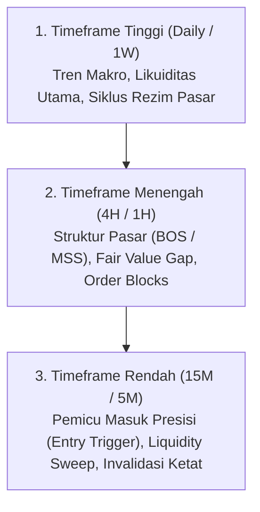

# Katalog Keahlian Sistem: MarketMind AI Professional (skills.md)

---

## 1. Keahlian Analisis Visual Pasar & Konfluensi Top-Down

Sistem menguasai pembacaan visual grafik (*Chart Vision*) lintas-instrumen (Crypto, Forex, Saham, Komoditas Emas, dan Indeks) dengan hierarki top-down terstruktur:



### Taksonomi Pola Visual yang Dikuasai:
1. **Smart Money Concepts (SMC) & ICT:**
   * Deteksi *Fair Value Gap* (FVG) dan ketidakseimbangan likuiditas (*Imbalance*).
   * Identifikasi *Liquidity Sweep* di atas *Buy-Side Liquidity* (BSL) atau di bawah *Sell-Side Liquidity* (SSL).
   * Penandaan *Breaker Blocks*, *Mitigation Blocks*, dan pergeseran struktur (*Market Structure Shift* / MSS).
2. **Pola Candlestick & Price Action Klasik:**
   * Analisis *Rejection Wicks*, *Engulfing Candles*, *Pin Bars*, *Inside Bars*.
   * Pola pembalikan & kelanjutan: *Head and Shoulders*, *Double Top/Bottom*, *Ascending/Descending Triangles*, *Bull/Bear Flags*, dan *Wedges*.
3. **Analisis Fraktal & Harmonik:**
   * Penarikan rasio Fibonacci Retracement (0.5, 0.618 Golden Pocket, 0.786).
   * Penentuan *Potential Reversal Zone* (PRZ) untuk pola Gartley, Bat, Butterfly, dan Crab.
4. **Indikator Teknis Pendukung:**
   * Divergensi momentum (RSI Bullish/Bearish Divergence).
   * Penjajaran Moving Average (EMA 20/50/200 Trend Alignment) dan Donchian Channels.

---

## 2. Keahlian Matematika Finansial & Risiko Kuantitatif

Sistem menerapkan disiplin komputasi matematis di sisi server untuk memvalidasi setup sebelum dapat disetujui:

### A. Average True Range (ATR14) & Batas Deviasi
* Dihitung dari 200 candle historis terakhir pada timeframe eksekusi:
  $$\text{TR} = \max(\text{High} - \text{Low}, |\text{High} - \text{Close}_{\text{prev}}|, |\text{Low} - \text{Close}_{\text{prev}}|)$$
  $$\text{ATR}_{14} = \text{SMA}(\text{TR}, 14)$$
* **Toleransi Realistis:** Level entry dan Stop Loss dibandingkan terhadap harga live. Deviasi $> 5 \times \text{ATR}$ memicu peringatan `far`; deviasi $> 25\%$ memicu penolakan kehandalan `setupReliable: false`.

### B. Rasio Risk-to-Reward Konservatif (R:R)
* Menghindari kalkulasi optimis: Pada posisi `LONG`, entry dihitung di batas atas zona beli (`entryHigh`); pada posisi `SHORT`, entry dihitung di batas bawah zona jual (`entryLow`).
  $$\text{Risk} = |\text{Entry} - \text{StopLoss}|$$
  $$\text{R:R Target 1} = \frac{|\text{TakeProfit1} - \text{Entry}|}{\text{Risk}}$$
* **Ambang Batas Minimum:** $\text{R:R} \ge 1:1.5$; jarak Stop Loss $\ge 0.1\%$ dari entry untuk mencegah tersapu *noise* spread.

### C. R-Multiple & Konsistensi Jurnal
* Menghitung efisiensi hasil perdagangan aktual:
  $$R = \frac{\text{ExitPrice} - \text{EntryPrice}}{\text{Risk}} \quad (\text{untuk Long})$$
* **Validasi Integritas:** Status *Win* wajib memiliki $R > 0$; *Loss* wajib memiliki $R \le 0$; *Breakeven* dibatasi $|R| \le 0.15$.

### D. Peringkat Akurasi Wilson Score 95%
* Untuk mencegah agent dengan 1 kemenangan dari 1 percobaan (100%) mengalahkan agent berkinerja stabil 80 kemenangan dari 100 percobaan, sistem menggunakan batas bawah interval Wilson:
  $$w = \frac{\hat{p} + \frac{z^2}{2n} - z \sqrt{\frac{\hat{p}(1-\hat{p})}{n} + \frac{z^2}{4n^2}}}{1 + \frac{z^2}{n}}$$
  *di mana $\hat{p} = \text{win-rate}$, $n = \text{total evaluasi}$, dan $z = 1.96$ untuk kepercayaan 95%.*

---

## 3. Keahlian Rekayasa Perangkat Lunak & Infrastruktur

```text
┌────────────────────────────────────────────────────────────────────────┐
│                        CORE ENGINEERING STACK                          │
├───────────────────┬───────────────────┬────────────────────────────────┤
│ FRONTEND / CLIENT │ BACKEND / RUNTIME │ INFRASTRUCTURE & DATA          │
├───────────────────┼───────────────────┼────────────────────────────────┤
│ • Next.js 15+ App │ • Node.js Server  │ • Supabase Postgres (RLS)      │
│ • React 18/19     │ • Route Handlers  │ • Supabase Storage (Private)   │
│ • Tailwind CSS    │ • Zod Validation  │ • Upstash Redis (REST API)     │
│ • Lightweight-    │ • Gemini 2.5 Flash│ • Binance Public Vision API    │
│   Charts v5 Canvas│ • React-PDF Engine│ • TwelveData REST API          │
└───────────────────┴───────────────────┴────────────────────────────────┘
```

### Kemampuan Teknis Spesifik:
1. **Pemrosesan Gambar Aman di Klien & Server:**
   * *Client-side:* Kompresi adaptif gambar menggunakan HTML5 Canvas (resolusi $\le 1920\text{px}$, format JPEG kualitas 0.82) sehingga payload unggahan tetap efisien.
   * *Server-side:* Validasi berkas biner murni (*Magic Bytes verification*) untuk memastikan berkas yang diunggah benar-benar berkas gambar asli (`FF D8 FF` untuk JPEG, `89 50 4E 47` untuk PNG, `52 49 46 46` untuk WebP).
2. **Caching Terdistribusi & Ketahanan Jaringan:**
   * *Single-Flight Execution:* Mencegah request ganda ke data provider secara bersamaan dengan menggabungkan promise request aktif.
   * *Stale-on-Error Fallback:* Menyajikan data candle terakhir ($\le 5\text{ menit}$) jika API Binance atau TwelveData mengalami gangguan sementara/rate limit.
3. **Penyusunan Dokumen PDF Server-Side:**
   * Kompilasi PDF langsung dari database menggunakan `@react-pdf/renderer` tanpa overhead Chromium/Puppeteer.
   * Sanitasi tipografi WinAnsi otomatis (mengonversi simbol matematika dan membuang emoji yang tidak didukung font sistem).
4. **Keamanan Integrasi Bot:**
   * Notifikasi Telegram berbasis *pairing token* 15 menit dengan verifikasi hash kriptografis SHA-256.
   * Penanganan webhook Discord anti-SSRF dengan whitelist domain ketat `https://discord.com/api/webhooks/`.
